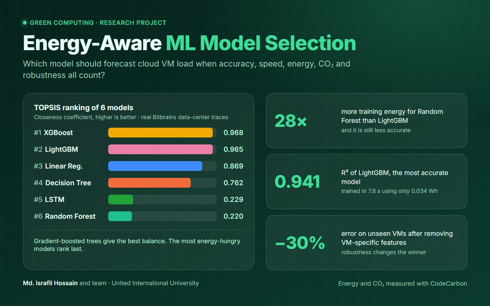
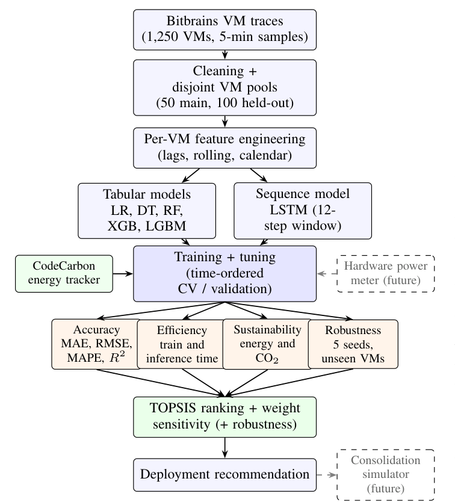
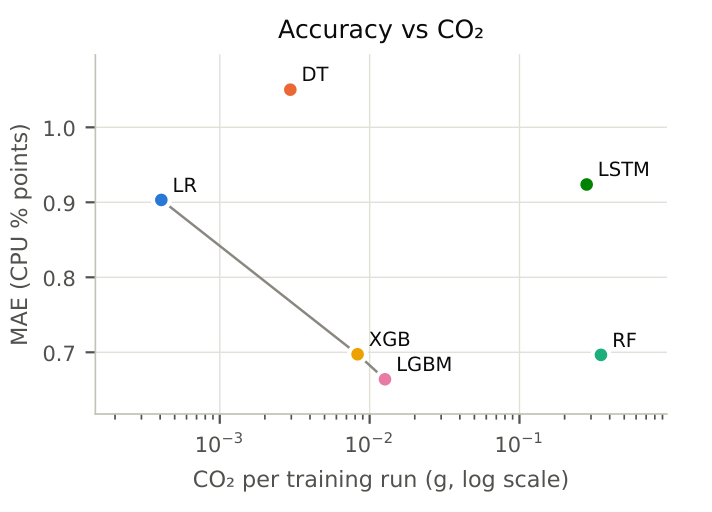
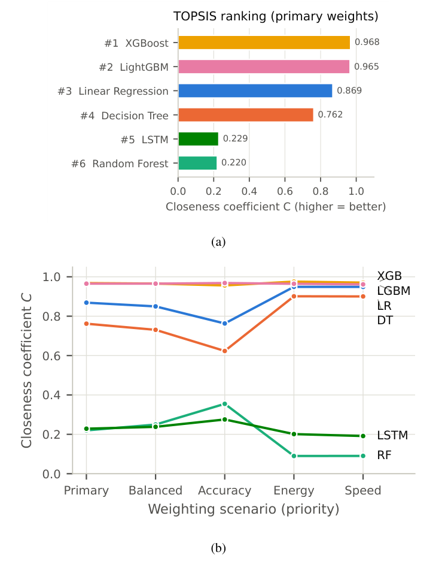
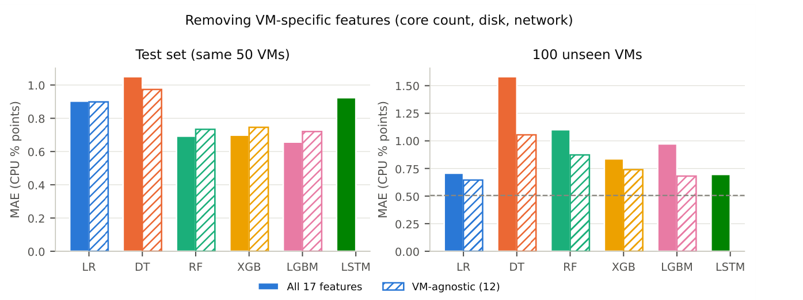

<div align="center">

# An Energy-Aware Evaluation Framework for Selecting Sustainable Machine Learning Models in Cloud Data Centers

**Choosing a VM load-forecasting model by accuracy, cost, energy, carbon *and* robustness, not by accuracy alone.**

[](paper/Energy_Aware_ML_Model_Selection_Paper.pdf)
[](requirements.txt)
[-F9AB00?logo=googlecolab&logoColor=white)](#reproducing-the-results)
[](http://gwa.ewi.tudelft.nl/datasets/gwa-t-12-bitbrains)

Md. Israfil Hossain · Ashiq Anzum · Navia Ferdous Nowrin · Naimur Rahman Nayeem · Taiamun Erabi Rafin · Nur Amin

Department of Computer Science and Engineering, United International University, Dhaka, Bangladesh<br>
Course: EEE 4261 (E): Green Computing

**[Read the paper (PDF)](paper/Energy_Aware_ML_Model_Selection_Paper.pdf)**



</div>

---

## Overview

Cloud operators use machine learning to forecast the CPU load of their virtual machines (VMs), so they can consolidate
work and switch idle servers off. The forecasting model is usually picked on accuracy alone, even though the models
themselves cost time and energy, and the most accurate model on familiar machines can fail on new ones.

This project builds a **reproducible framework** that evaluates every candidate model on four dimensions and ranks
them with **TOPSIS**, a multi-criteria decision method:

| Dimension | What is measured |
|---|---|
| Prediction accuracy | MAE, RMSE, MAPE, R² |
| Computational efficiency | training time, inference time per 1,000 predictions |
| Environmental sustainability | energy (Wh) and CO₂ per training run, measured with CodeCarbon |
| Robustness | stability over 5 random seeds, accuracy on 100 VMs never seen in training |

Six models are compared on real production traces from the public **GWA-T-12 Bitbrains** dataset: Linear Regression,
Decision Tree, Random Forest, XGBoost, LightGBM and an LSTM. A persistence forecast (ŷₜ₊₁ = yₜ) is the reference that
every useful model must beat. All experiments ran on the free CPU tier of Google Colab, so every model was trained on the
same hardware and its energy can be compared directly.

<p align="center">
  <br>
  <em>The framework (Fig. 2 of the paper). Dashed boxes are planned extensions.</em>
</p>

## Key findings

- **Gradient-boosted trees give the best balance.** LightGBM is the most accurate model (MAE 0.664 CPU percentage
  points, R² 0.941) and trains in 7.8 s using 0.034 Wh. XGBoost ranks first in TOPSIS (C = 0.968) with LightGBM a very
  close second (0.965).
- **The most expensive models are not the most accurate.** Random Forest and the LSTM use 28× and 22× the training
  energy of LightGBM and are still less accurate. They rank last under every weighting scenario.
- **Hyperparameter tuning cost more than it returned.** 53.4 minutes of tuning improved accuracy by at most 1.5%.
- **On unseen VMs the ranking reverses.** On 100 held-out VMs the LSTM (0.696) and Linear Regression (0.707) beat
  LightGBM (1.083) and Random Forest (1.095). The tree ensembles rely on VM-specific disk and network features.
- **A simple fix works.** Removing the 5 VM-specific features cuts LightGBM's unseen-VM error by 30% (0.972 → 0.681) at a
  6–10% cost on known VMs. With robustness as a criterion, TOPSIS recommends the VM-agnostic LightGBM (C = 0.967).
- **Deep learning does not justify its cost here.** The LSTM was less accurate on known VMs, the least stable across
  seeds and the slowest at inference.

## Results at a glance

Tuned models on the test set (50 VMs, 80,303 test rows). Energy and CO₂ are per training run.

| Model | MAE ↓ | R² ↑ | Train time (s) ↓ | Energy (Wh) ↓ | TOPSIS C ↑ | Rank | MAE on 100 unseen VMs ↓ |
|---|---:|---:|---:|---:|---:|:-:|---:|
| Linear Regression | 0.903 | 0.906 | **0.25** | **0.0011** | 0.869 | 3 | 0.707 |
| Decision Tree | 1.050 | 0.916 | 2.04 | 0.008 | 0.762 | 4 | 1.581 |
| Random Forest | 0.697 | 0.937 | 195 | 0.95 | 0.220 | 6 | 1.095 |
| XGBoost | 0.697 | 0.939 | 5.92 | 0.022 | **0.968** | **1** | 0.919 |
| LightGBM | **0.664** | **0.941** | 7.82 | 0.034 | 0.965 | 2 | 1.083 |
| LSTM | 0.924 | 0.910 | 159 | 0.76 | 0.229 | 5 | **0.696** |
| *Persistence (reference)* | 0.733 | 0.904 | – | – | – | – | 0.506 |

MAE is in CPU percentage points. TOPSIS weights: accuracy 0.65 in total, training time 0.15, CO₂ 0.20.

<table>
  <tr>
    <td width="50%" align="center"><br>
      <em>Error vs CO₂ per training run (log scale). The grey line is the Pareto front.</em></td>
    <td width="50%" align="center"><br>
      <em>TOPSIS ranking with the primary weights (a) and under five weighting scenarios (b).</em></td>
  </tr>
</table>

<p align="center">
  <br>
  <em>Full-feature (solid) vs VM-agnostic (hatched) models. The dashed line is persistence on the unseen VMs.</em>
</p>

## Dataset

[GWA-T-12 Bitbrains](http://gwa.ewi.tudelft.nl/datasets/gwa-t-12-bitbrains), *fastStorage* trace, from the Grid
Workloads Archive (TU Delft). It holds 1,250 VMs of an enterprise hosting provider, sampled every 5 minutes from
12 August to 11 September 2013. Each reading has CPU, memory, disk and network usage.

- 2,663,335 raw rows were cleaned. VMs powered off for more than 10% of the time were excluded (35 VMs), and CPU values
  above 100% were capped (32,131 values).
- Main experiment: 50 VMs, split by time (first 80% train, last 20% test): 321,115 training and 80,303 test rows.
- Generalization test: 100 separate VMs that are never used for training or tuning (815,778 predictions).

The raw data is **not included** in this repository because of its size (about 1.8 GB with the processed files). The
VM selection (`data/processed/vm_selection.csv`) and feature list (`data/processed/feature_columns.json`) are included,
so the same VMs and features can be rebuilt.

## Repository structure

```
├── notebooks/            # the full pipeline, one notebook per phase (run in order)
├── scripts/              # shared code: config, models, energy tracking, plotting, paper helpers
├── results/
│   ├── tables/           # every result table as CSV (+ PNG preview)
│   ├── charts/           # all figures (PNG and PDF)
│   └── logs/             # run logs and raw CodeCarbon measurements
├── paper/
│   ├── Energy_Aware_ML_Model_Selection_Paper.pdf
│   ├── final/            # LaTeX source (IEEE format), figures, tables, references.bib
│   └── literature_review/
├── data/processed/       # VM selection and feature list (raw data not included)
└── docs/images/          # figures used in this README
```

### Notebooks

| # | Notebook | What it does |
|---|---|---|
| 01 | `01_data_preprocessing` | Loads and cleans the Bitbrains traces, selects two separate VM pools |
| 01b | `01b_feasibility_check` | Times each model on free Colab and sizes the experiment to fit |
| 02 | `02_feature_engineering` | Builds 17 per-VM features (lags, rolling stats, calendar), leakage checks, time-based split |
| 03 | `03_model_training` | Trains the six models with default settings plus the persistence baseline |
| 04 | `04_hyperparameter_tuning` | Grid search with time-ordered cross-validation; LSTM configuration search |
| 05 | `05_sustainability_tracking` | Measures training and inference energy and CO₂ with CodeCarbon |
| 06 | `06_stability_testing` | Retrains every model with 5 random seeds |
| 07 | `07_topsis_ranking` | Multi-criteria ranking with TOPSIS |
| 08 | `08_sensitivity_analysis` | Five weighting scenarios and a continuous weight sweep |
| 09 | `09_generalization_test` | Evaluates the models on 100 unseen VMs |
| 10 | `10_visualization_export` | Produces all charts and tables |
| 11 | `11_extensions` | VM-agnostic features, robustness-aware TOPSIS, fleet projection, significance tests |

Every notebook saves its results as it goes and can resume after a Colab disconnect.

## Reproducing the results

1. **Get the data.** Download the GWA-T-12 Bitbrains *fastStorage* trace and save the zip as
   `data/raw/bitbrains_fastStorage.zip` (or extract it to `data/raw/fastStorage/2013-8/`).
2. **Place the project.**
   - *Google Colab (what we used):* copy the repository to Google Drive as `MyDrive/Green_ML_Project`. The notebooks
     find it automatically after mounting Drive.
   - *Anywhere else:* set the environment variable `GREEN_ML_ROOT` to the repository folder.
3. **Install the packages.**
   ```bash
   pip install -r requirements.txt
   ```
4. **Run the notebooks in order** (01 → 11) on a CPU runtime. The full pipeline takes about 4.5 hours on free Colab,
   and no single notebook needs more than about 2 hours.

Setup used for the paper: Google Colab (free), Intel Xeon 2.20 GHz, 2 vCPUs, 13.6 GB RAM, Python 3.13,
scikit-learn 1.6.1, XGBoost 3.4.1, LightGBM 4.6.0, PyTorch 2.11 (CPU), CodeCarbon 3.3.1.
`scripts/verify_paper_numbers.py` checks the numbers in the paper against the result files.

## Limitations

CodeCarbon estimates energy from the processor's rated power rather than measuring it, so absolute values may differ
from metered consumption. Relative comparisons on the same hardware are more reliable. The study uses one dataset from
2013 and a single 5-minute forecast horizon. See Section VI of the paper for the full discussion and future work.

## Citation

```bibtex
@misc{hossain2026energyaware,
  title  = {An Energy-Aware Evaluation Framework for Selecting Sustainable Machine Learning Models in Cloud Data Centers},
  author = {Hossain, Md. Israfil and Anzum, Ashiq and Nowrin, Navia Ferdous and Nayeem, Naimur Rahman and
            Rafin, Taiamun Erabi and Amin, Nur},
  year   = {2026},
  note   = {Course project, EEE 4261 (E): Green Computing, United International University},
  url    = {https://github.com/Israfil0077/energy-aware-ml-model-selection}
}
```

## Acknowledgment

The GWA-T-12 Bitbrains trace was provided by Bitbrains IT Services Inc. and is distributed through the Grid Workloads
Archive maintained by TU Delft.
