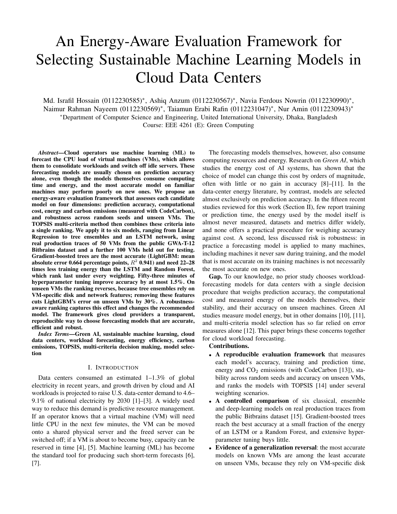
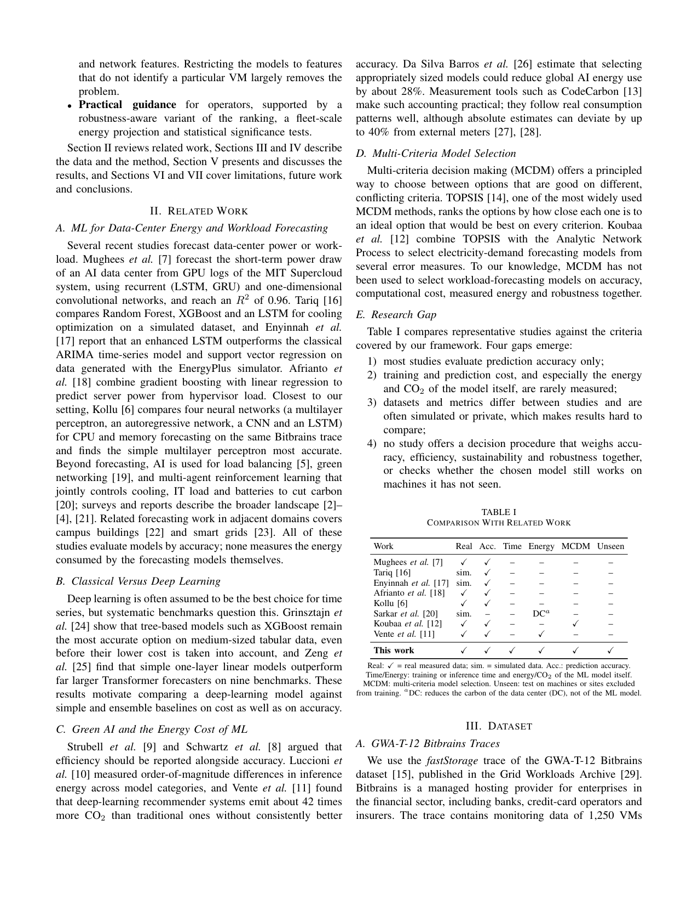
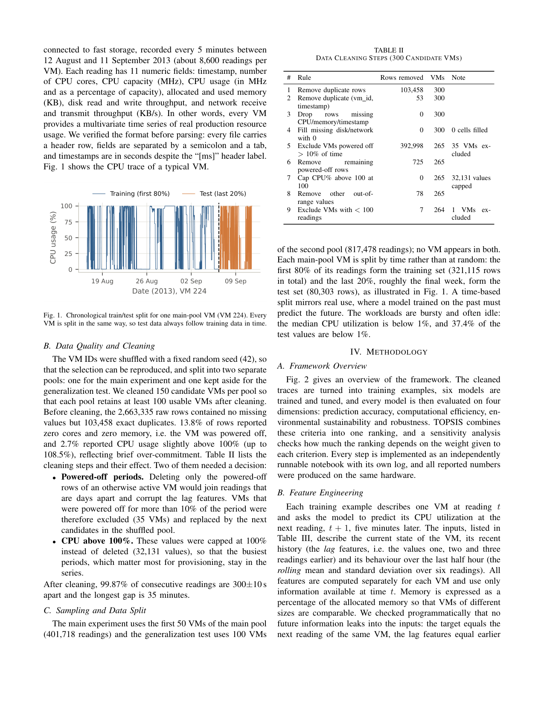
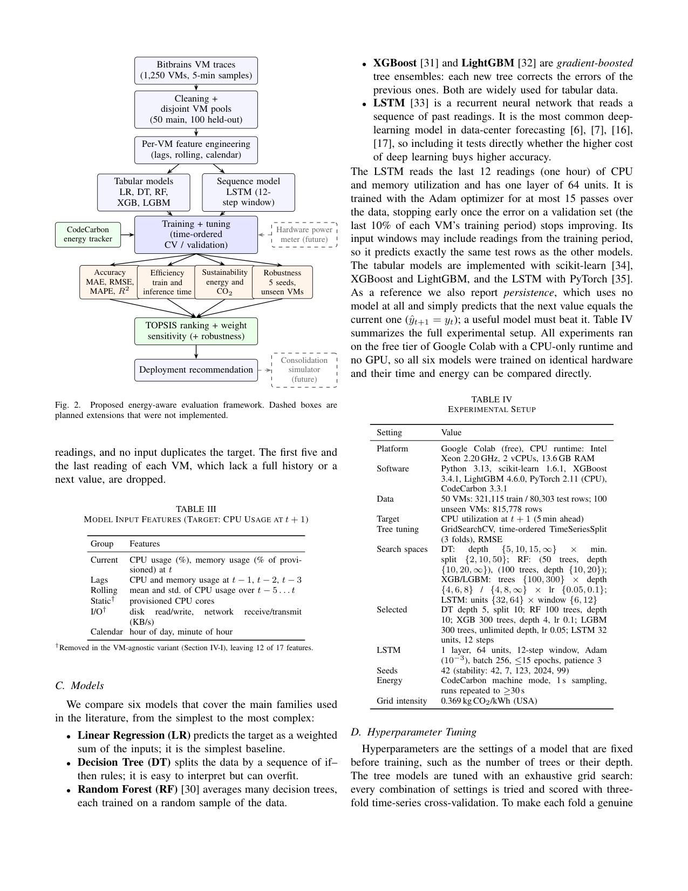
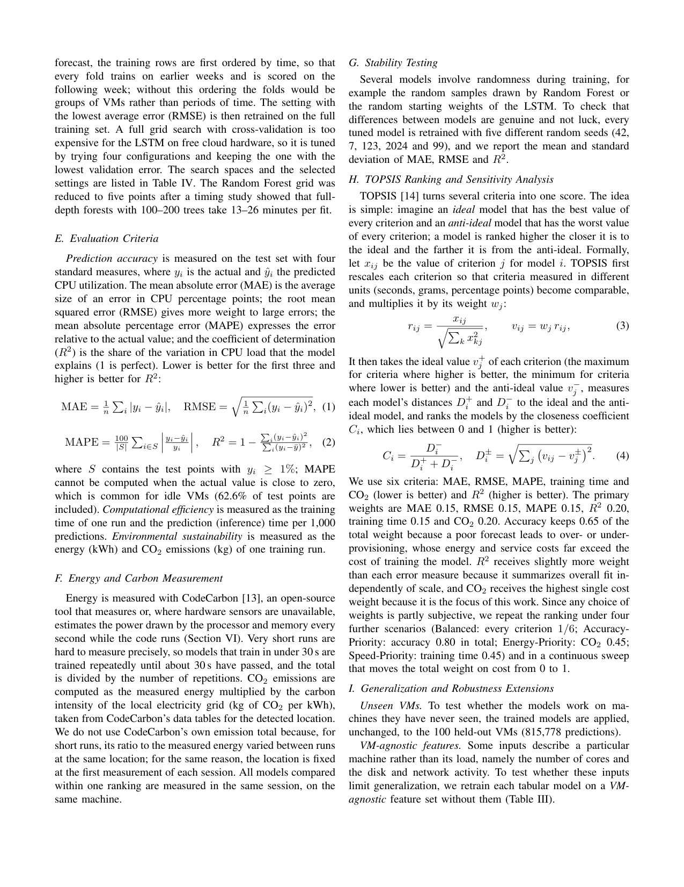
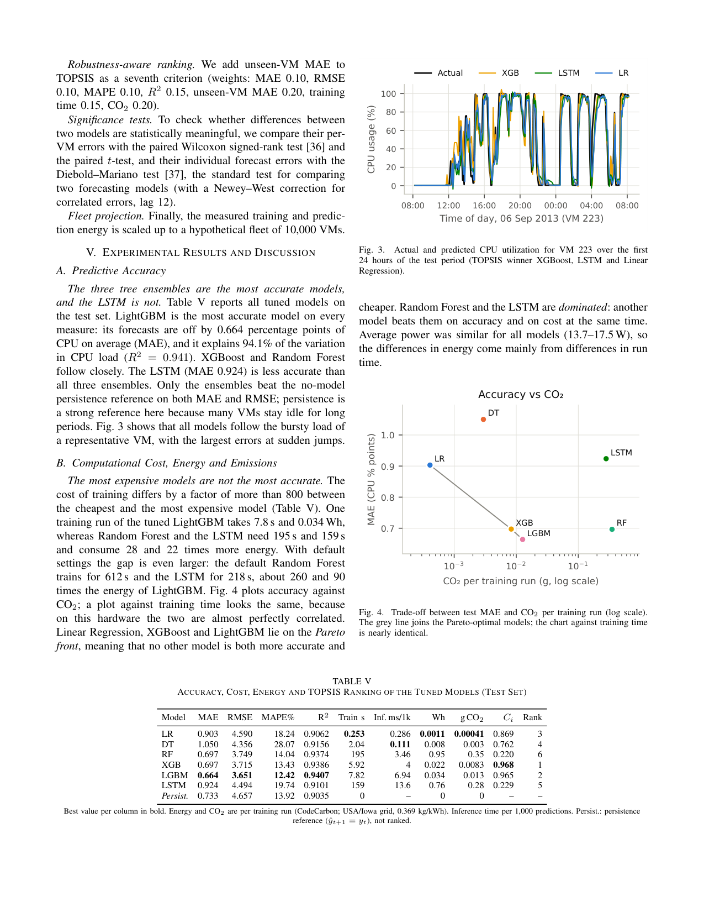
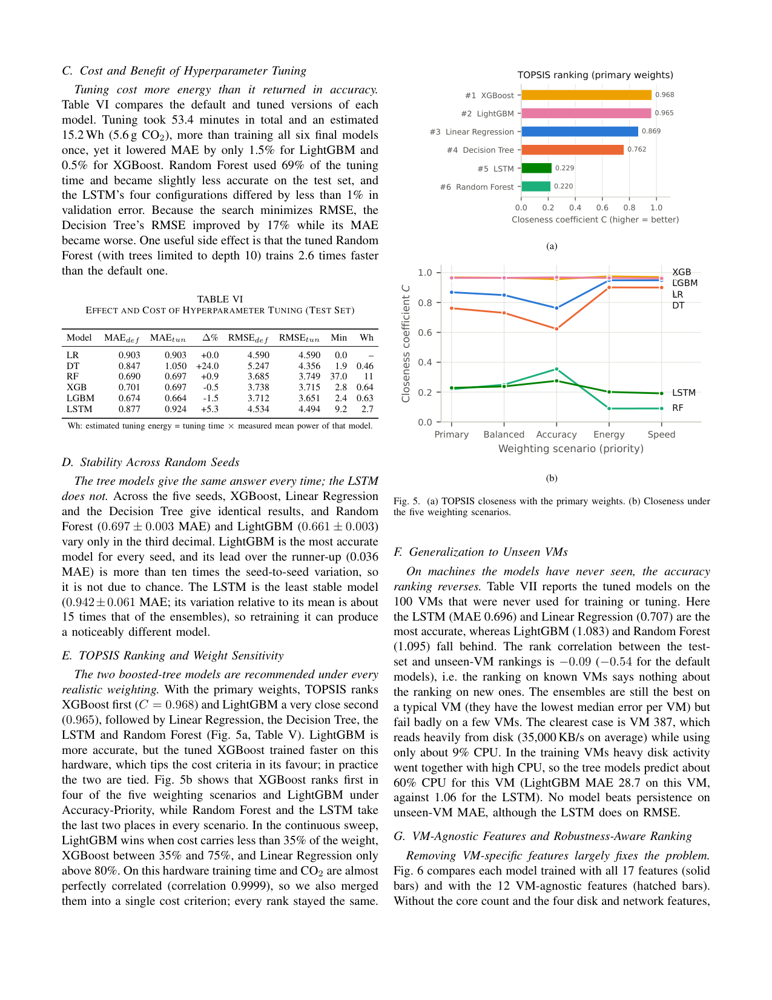
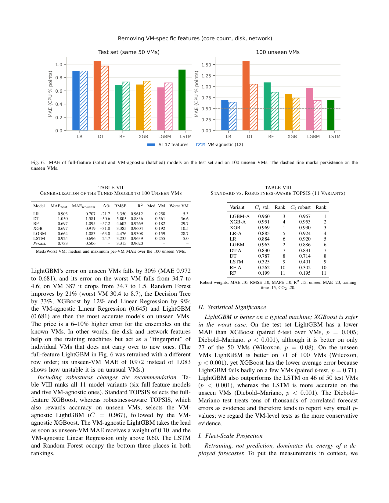
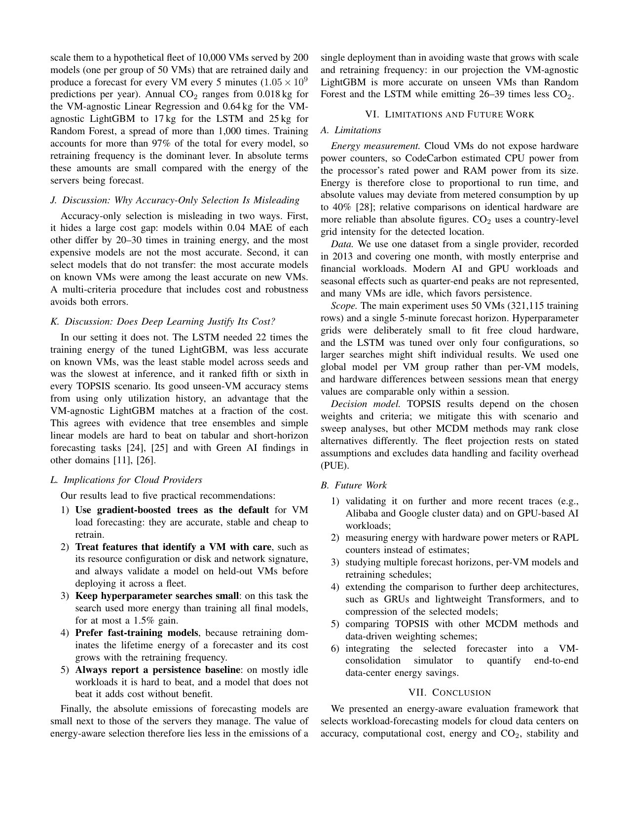
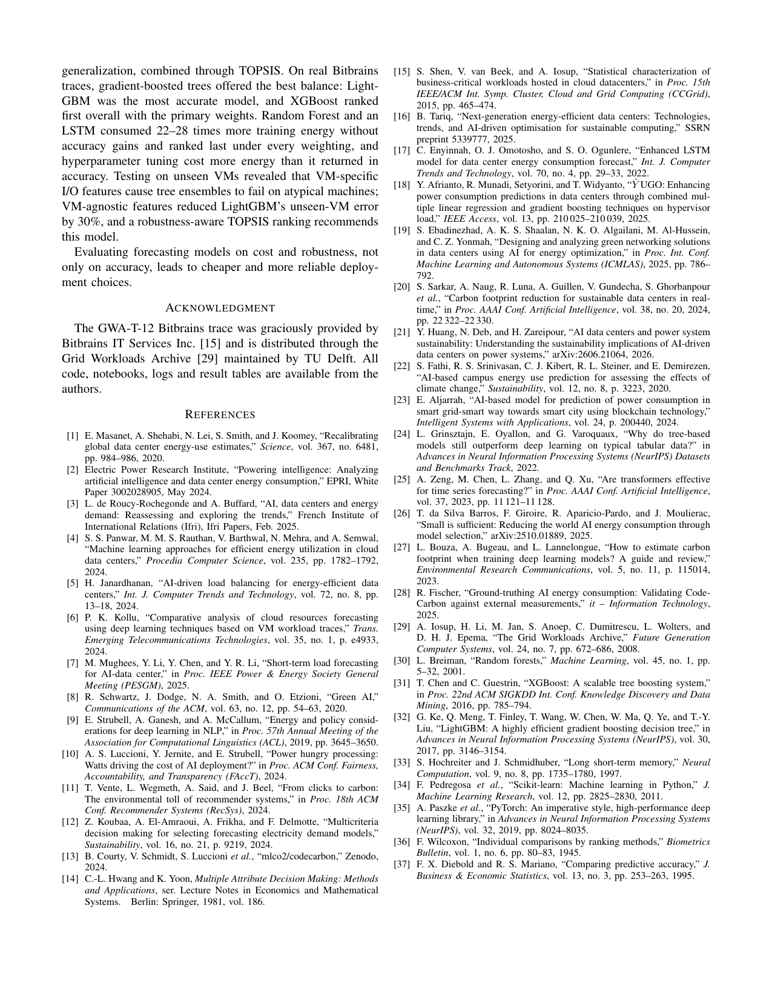

# Paper

**An Energy-Aware Evaluation Framework for Selecting Sustainable Machine Learning Models in Cloud Data Centers**

**[Download the PDF](https://github.com/Israfil0077/energy-aware-ml-model-selection/raw/main/paper/Energy_Aware_ML_Model_Selection_Paper.pdf)** · LaTeX source in [`final/`](final/)

The pages are shown below as images, so the paper can be read here without opening the PDF.

### Page 1

### Page 2

### Page 3

### Page 4

### Page 5

### Page 6

### Page 7

### Page 8

### Page 9

### Page 10

